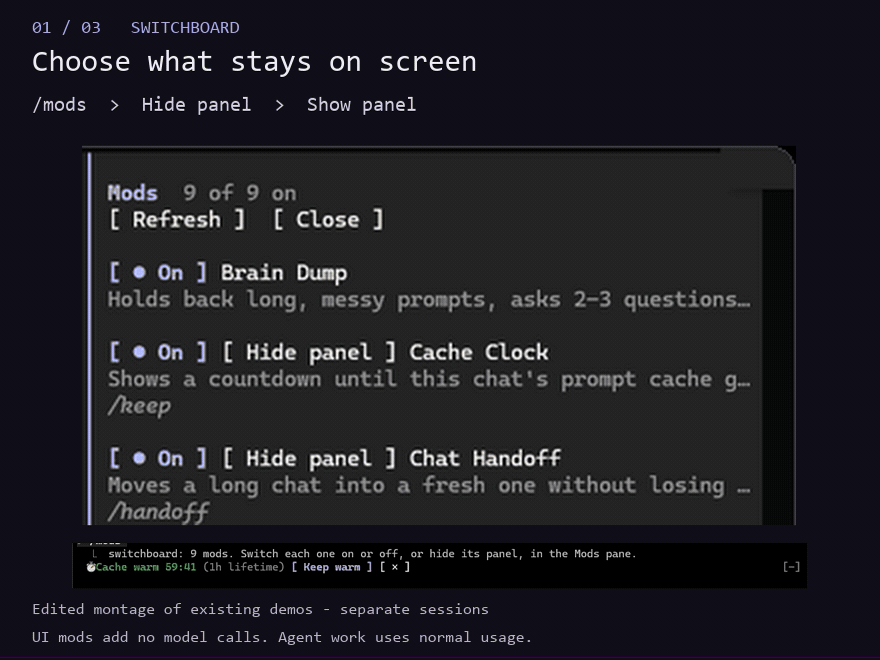
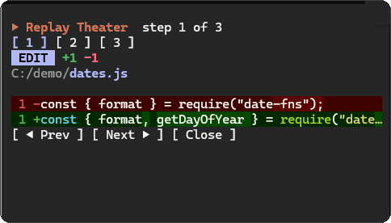
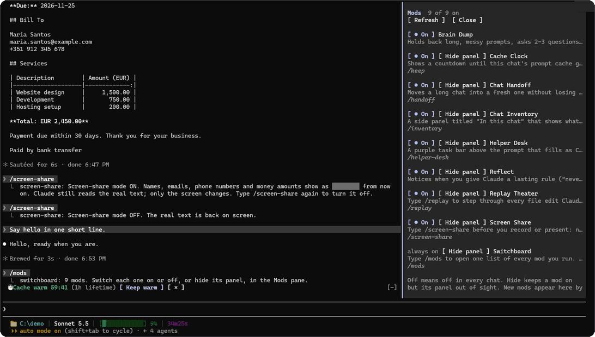
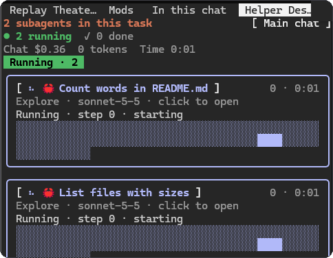
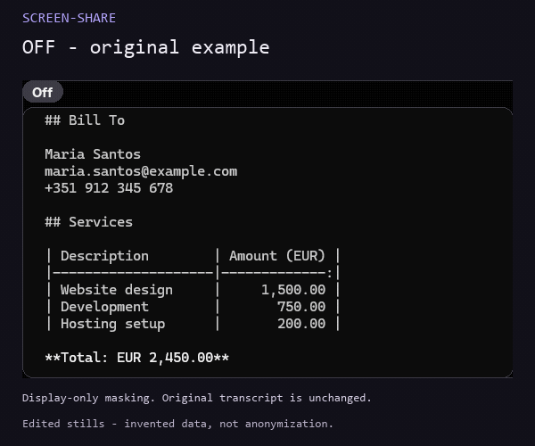
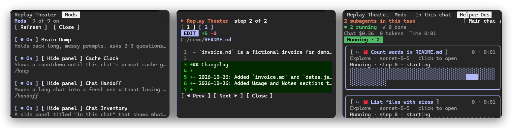

# Claude Code Mods

See what changed. Follow the work. Keep long sessions readable.

Nine focused mods for developers who lose track of edits, subagents and context in long Claude Code sessions. Review changes, follow task progress and choose what stays on screen.

[](#try-a-mod)
[](#choose-a-mod)
[](docs/portfolio/evidence.md)

[](LICENSE)
[](docs/portfolio/evidence.md)

**Source snapshot:** nine mods, manifests `0.1.0`, no tags or GitHub releases as of 4 November 2026. Built on the early-access mod API; compatibility across versions and surfaces is not established.

## Watch three workflows in one loop

**Choose your panels → review an edit → follow task progress.** The loop moves through Switchboard, Replay Theater and Helper Desk, with each command and result labelled.



*16.2-second edited montage of three existing demos, not a continuous session or a new recording. It loops automatically; it is not an interactive slider. These UI mods add no model calls, while the work they display uses normal Claude usage. Individual examples are available below.*

## Choose a mod

The code is free under MIT. Claude access and model usage are separate; “no extra calls” below refers only to the mod's own behaviour.

| Mod | Use it to… | Extra model calls |
|---|---|---|
| [**replay-theater**](plugins/replay-theater) | Review the last editing turn: `/replay`. | None |
| [**switchboard**](plugins/switchboard) | Choose visible panels and enabled mods: `/mods`. | None |
| [**helper-desk**](plugins/helper-desk) | Follow tasks and subagents: `/helper-desk`. | None; agents still use normal usage. |
| [**chat-inventory**](plugins/chat-inventory) | Track tools, skills and files: `/inventory`. | None |
| [**cache-clock**](plugins/cache-clock) | See cache expiry; optionally keep it warm. | Timer: none. Keep warm: repeated requests. Requires Node.js. |
| [**chat-handoff**](plugins/chat-handoff) | Prepare a fresh chat: `/handover`. | Chat fork, with Sonnet fallback; cold-cache re-cache can cost more. |
| [**reflect**](plugins/reflect) | Choose where to save a standing rule. | One Haiku check per eligible prompt. |
| [**brain-dump**](plugins/brain-dump) | Turn a rambling prompt into a draft to review. | Normally two Sonnet calls at 120+ words. |
| [**screen-share**](plugins/screen-share) | Mask matching text on screen: `/screen-share`. | None. Visual patterns, not anonymization. |

Actual charges depend on your plan/provider, model, context and cache state. Keep warm is opt-in, consumes usage and is not a savings guarantee. Chat Handoff's cold-cache trigger depends on Cache Clock.

<details>
<summary><strong>Model usage and dependencies in detail</strong></summary>

Cache Clock's timer reads the transcript using Node.js on PATH. Keep warm sends fork requests reading cached context; it stops on your next prompt, after two hours, or with `/keep off`.

Chat Handoff forks the chat, falling back to a Sonnet call when there is no snapshot. A cold cache can require a full re-cache. It offers a button before starting the fresh chat.

Reflect checks eligible prompts of at least two words and at most 600 characters; commands/meta prompts are excluded. Saving requires a click. Its vault destination needs configuration. Brain-Dump normally uses two Sonnet calls for eligible composer prompts of **120 words or more**; `!!` bypasses refinement.

Switchboard invokes local plugin commands. Inventory reflects the session events/transcript it can observe. Hiding a panel does not stop a mod's other behaviour or model calls.

</details>

## More ways to see the work

<details>
<summary><strong>Replay Theater — inspect each edit</strong></summary>

After Claude edits a file, run `/replay`. Use `Next` and `Prev` to compare removed and added lines in the last editing turn.



*Existing demo: `C:/demo/dates.js`. Replay adds no model calls and covers Edit/Write events after loading. Shell edits are outside its coverage. It is a viewer, not undo.*

</details>

<details>
<summary><strong>Switchboard — choose what stays on screen</strong></summary>

Run `/mods` (or `/switchboard`). `Hide panel` removes Cache Clock's band; `Show panel` restores it without disabling the mod.



*The invoice data is invented, as confirmed by Cisco. Visibility changes immediately; enabling or disabling a mod may require a new chat.*

</details>

<details>
<summary><strong>Helper Desk — follow tasks and subagents</strong></summary>

Open `/helper-desk` to see agents move from running to finished. This example counts README words and lists files in a demo project.



*The mod makes no model calls of its own. The agents it displays still consume normal Claude usage.*

</details>

<details>
<summary><strong>Screen-Share — compare visual masking off and on</strong></summary>

This six-second loop turns the existing before/after screenshot into a sequential comparison. All invoice data is invented. It is an edit of two still images, not footage of a command being executed.



*Display-only pattern masking, not anonymization. The model and stored transcript retain the original text. Some line-item amounts remain visible in this example. See the privacy limits below before recording.*

</details>

<details>
<summary><strong>Overview — three views side by side</strong></summary>



*Existing overview image. Use the individual examples for readable detail on narrow screens.*

</details>

These are existing examples and clearly labelled edits, not new runtime acceptance of current source. The [media plan](docs/portfolio/media-plan.md) records inputs, crops and rendering steps. The gallery uses GitHub's expandable sections; the main GIF supplies the automatic sequence without JavaScript.

## Try a mod

Use a Claude Code environment that supports mods and permits them under its policies. The old README declared `2.1.292+`; the recorded API baseline was `2.1.310`. Neither is a tested support range. Current upstream guidance says terminal mods are on by default from `2.1.287`; that does not prove these nine work on every later version. See [upstream mod guidance](https://code.claude.com/docs/en/plugins/mods/overview) and the [dated evidence matrix](docs/portfolio/evidence.md).

Start with **Replay Theater**, which adds no model calls. Review its [source](plugins/replay-theater/hooks) before installing; mods run with your account's permissions.

Inside Claude Code:

```text
/plugin install replay-theater --marketplace FCisco95/claude-code-mods
```

Start a new session after installation. Once Claude makes an Edit/Write change, `/replay` should show that change. Generating the edit still uses Claude normally; opening Replay adds no model request. Installation and this live flow were **not run** during the documentation audit.

Prefer a local clone? The included scripts copy selected mods into `skills` beneath `CLAUDE_CONFIG_DIR` (or `~/.claude` by default) and default to all nine. **Reinstallation deletes and replaces each selected mod folder, including local customizations.** Read [installation, update, disable and rollback](docs/portfolio/installation.md) before running them. Cache Clock needs Node.js; install it alongside Chat Handoff for the cold-cache trigger.

## Privacy and limits

**Screen-Share is visual pattern matching, not anonymization or a security boundary.** The model, transcript and files retain the original content. Names can be missed and ordinary phrases can be hidden by mistake. The prompt box, terminal title, shell prompt and other mods' status lines are not covered; path fields are deliberately preserved. Strings over 500,000 characters pass through unchanged. Use invented data for recordings and inspect every frame. Its [implementation](plugins/screen-share/hooks/mask.ts) is the source of these limits; some older per-mod prose makes broader claims.

Reflect and Brain-Dump send eligible prompt text through Claude Code's model API. Handoff processes conversation context and saves a local Markdown handoff under `~/.claude/handoffs/`. Reflect can write rules, project memory or a configured vault. Review those outputs before sharing; installing the code does not make private sessions safe to publish.

Replay keeps the last 200 edit steps and caps displayed changed lines per step at 200. Helper Desk and Chat Inventory open automatically only when the terminal is wide enough (144 columns, or 110 after manual opening); their commands can open them at any width. Narrow panels can truncate content.

## How it is built

Each mod is an independent plugin folder: a manifest, `hooks/hooks.json` and TypeScript handlers. UI mods listen to session/tool events and draw panes or stacked bands; the model-assisted mods explicitly call Claude Code's model API. There is no separate service to deploy in this repository.

<details>
<summary><strong>Architecture, validation and contribution</strong></summary>

| Part | Source / tradeoff |
|---|---|
| Discovery | [Marketplace catalog](.claude-plugin/marketplace.json); independent installable folders under [plugins](plugins). |
| Local installation | [Shell](install.sh) and [PowerShell](install.ps1) copy folders; no built-in merge, backup or rollback. |
| Event-driven UI | [Replay handlers](plugins/replay-theater/hooks/register.tsx), [task cards](plugins/helper-desk/hooks/register.tsx); limited to the events the host exposes. |
| Validation | Six mods contain test files. Historical README reports manual sessions and `claude plugin validate`; no retained version/platform test matrix. No product tests were run for this documentation change. |

Still without recorded live acceptance: Chat Handoff's cold-cache offer, Brain-Dump's long-prompt hold and Reflect's `Save to vault`. `/handoff` may conflict with another plugin; use `/handover`. Switchboard can leave existing UI in an open chat after disabling a mod; use a new chat, or the mod's own toggle where available.

For source changes, add the plugin folder and marketplace entry, validate it in a suitable Claude Code environment, and record the version/platform and outcome. [Verification notes and commit-based history](docs/portfolio/evidence.md) distinguish source inspection from tests and releases.

</details>

## Credit and license

Cache Clock is inspired by Karan Binsal's “cache tax” mod. Written by [Cisco Vieira](https://github.com/FCisco95) with Claude Code. [MIT license](LICENSE). Independent project; no universal compatibility or official support claim.
