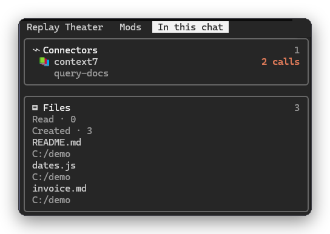

# Chat Inventory

A Claude Code mod that adds a side panel titled "In this chat", so a long task is not a black box.



*The "In this chat" panel: connectors with a call count, and the files read and created. Nothing here costs a model call.*

The panel lists, live:

- **To-do**: the list Claude is working through, with the goal at the top, `3 of 6` and a tick, a marker or a circle per step.
- **Connectors**: every connector (MCP server) Claude calls, with the last tool it used and a call count that goes up with each call. A CRM, an email and a drive show up as three entries.
- **Files**: the files Claude reads, and the files it creates, kept apart. A file written over an existing one counts as neither.
- **Skills**: every skill used, with a use count.

It only watches and draws. It makes no model calls, so it costs nothing to run.

## How it captures

It listens to the events Claude Code raises inside the session: each tool call (connector calls are the tools named `mcp__<server>__<tool>`), each skill load, and the to-do list as Claude writes it (`TodoWrite`, the task tools, or `work_state_write`). A call is counted once it has run, so a call that was refused is not counted. A chat that was already running when the mod started is rebuilt once from its transcript.

The **goal** is the first sentence of the prompt that was current when the to-do list started, since a to-do list has no title of its own.

## Open it

The panel opens by itself when a session starts. Close it whenever you like; `/inventory` opens it again. On its own it only shows on a wide enough terminal (144 columns, or 110 once you have opened it yourself); `/inventory` opens it at any width.

## Limits

- Connectors get an emoji (📧 mail, 📅 calendar, 📁 drive and a few more) or a coloured initial, not the service's logo: a terminal panel can only draw pictures where the terminal supports them, and Orca's does not. The emoji list is the `ICONS` table in `hooks/capture.ts`.
- Calls made before the mod started are counted only from the transcript, and only for tools and skills it records.
- The counts are per chat; `/clear` starts them over.
- Claude Code only.

## Install

```
/plugin install chat-inventory --marketplace FCisco95/claude-code-mods
```

Or copy `plugins/chat-inventory` to `~/.claude/skills/chat-inventory` (see the [repo README](../../README.md)).
