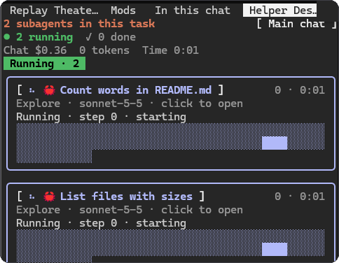

# Helper Desk

A Claude Code mod that shows what Claude and its subagents are doing, without a single model call.



*Two subagents running in parallel, then finishing: one card each, with step, model, tokens and time.*

- **Task bar.** A purple bar above the prompt fills as Claude ticks off its to-do list.
- **Subagent panel.** A side panel with one live card per subagent: its step, model, tokens and time. It opens by itself when a session starts, on a wide enough terminal (144 columns, or 110 once you have opened it yourself). Close it whenever you like; `/helper-desk` opens it again at any width.

It only reads what Claude Code already reports, so it adds no cost.

## Notes

- Claude Code only.

## Install

```
/plugin install helper-desk --marketplace FCisco95/claude-code-mods
```

Or copy `plugins/helper-desk` to `~/.claude/skills/helper-desk` (see the [repo README](../../README.md)).
