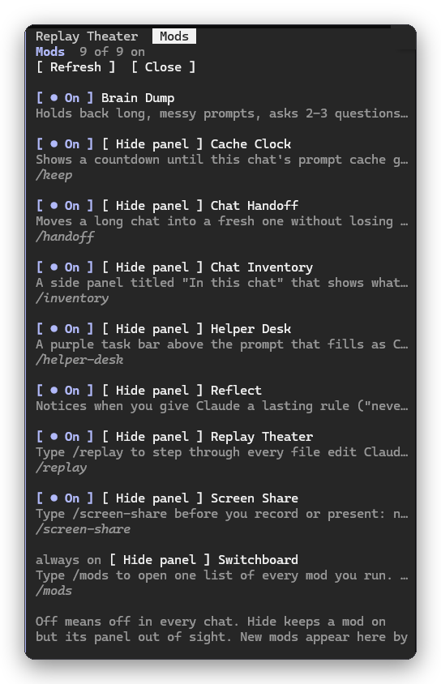

# Switchboard

A Claude Code mod for keeping track of your mods. Type `/mods` and one list opens with every mod you run: its name, what it does, its slash command, and a switch to turn it on or off. A mod that adds a pane or a band to your screen also gets a `Hide panel` button. Mods you add or remove later show up in the list by themselves.

*/mods: one list of every mod, each with an on/off switch and, where it has one, a Hide panel button.*

Once you build, install and test a lot of mods, it is easy to lose track of which ones are on. This is the one place that tells you, and lets you switch one off in the middle of a chat when it gets in the way.

## Use

| Command | What it does |
| --- | --- |
| `/mods` | Open the list (also `/switchboard`, which always works even if `/mods` is taken) |

In the list:

- `● On` / `○ Off` switches a mod on or off. This is the same as `claude plugin disable` and `claude plugin enable`: it is off in every chat, not just this one.
- `Hide panel` / `Show panel` keeps the mod on but stops its pane or band from being drawn. Hidden panels stay hidden until you show them again.
- `Refresh` reads the list again. While the list is open it also refreshes by itself every 5 seconds.
- Switchboard itself shows as always on, so you cannot switch off the list you are using.

## What counts as a mod

Any enabled or disabled plugin whose `hooks/hooks.json` names a hooks module: your own mods in `~/.claude/skills`, and mods installed from a marketplace. Plain skills, agents and commands are left out. The row's text comes from the mod's `plugin.json`, and its slash command from the first command the mod registers.

## Limits

- The switch runs `claude plugin enable` or `claude plugin disable` at the scope the mod was installed in, so it changes your settings file, and the list updates at once. In a chat that is already open, a mod you switched off can leave what it had already put on screen (a band above the prompt, say) until you start a new chat, and a mod you switched on may not have its slash command until you start one. To get a panel out of the way right now, use `Hide panel`.
- `Hide panel` on a pane swaps it for a one-line "Hidden" note; the tab stays. On a band above the prompt, the mod itself stops drawing it: Cache Clock, Chat Handoff, Helper Desk, Reflect and Screen-Share read the hidden list from Switchboard. A band from a mod that does not read that list cannot be hidden this way. A status line entry or a toast is never hidden.
- A mod shows `Hide panel` when its code opens a pane or draws a band. The check is a plain search of its source, so a mod that does it in an unusual way may be missing the button.
- Nothing is sent anywhere and no model is called. It runs `claude plugin list --json` on your machine.

## Install

Copy this folder to `~/.claude/skills/switchboard`, or install it from the repository's marketplace. It loads in every project.
